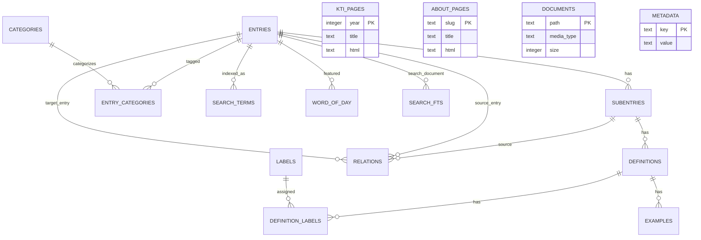

# Database design

The flat `kbbi.jsonl` view is useful for a quick dump, but it loses information
that the app actually presents:

- one headword page can contain several **subentries** (`AB (1)` … `ab (2)`,
  `e.lang (1)` … `e.lang`);
- each subentry can contain numbered **definitions**;
- part of speech, language, field, register, and labels belong to individual
  definitions, not just to the page;
- examples belong to definitions;
- compound words, proverbs, variants, derived words, and “bentuk tidak baku”
  links are typed **relations**;
- the home screen and the category screens are built from category tables, not
  from strings embedded in definitions;
- search needs an exact-headword/prefix index in addition to full text.

The normalized output is **`output/kbbi.sqlite`**, built with:

```bash
pixi run db
```

The builder is `scripts/build_db.py`; the schema/loader lives in
`src/kbbi_extract/database.py` and the CAV interpretation in
`src/kbbi_extract/structured.py`.

## Entity relationship overview



## Core tables

### `entries`

One row per `acu_nilai.txt` headword.  `id` is the **1-based word-list index**,
which is also the number used by CAV reference codes 40 and 41.  This makes
references directly joinable.

| Column | Meaning |
| --- | --- |
| `id` | 1-based word-list index |
| `headword` | exact word from `acu_nilai.txt` |
| `headword_folded` | case- and accent-folded search key |
| `source_block` | source `acu_desc_N` block |
| `source_offset` | offset in the CAV stream |

`headword_folded` is `NFKD` normalized, case-folded, and stripped of combining
marks.  It is identical to `headword` for most ASCII entries, but not for
accented or uppercase forms:

```sql
SELECT headword, headword_folded
FROM entries
WHERE headword <> headword_folded
LIMIT 5;
```

Examples: `à` → `a`, `abad al-abīd` → `abad al-abid`,
`accent circonflêxe` → `accent circonflexe`.  There are 241 such rows in
6.2.0.  Keep both: `headword` is the display value, `headword_folded` is for
case/accent-insensitive lookup.

### `subentries`

The display blocks shown on an entry page.  For `AB`, the page contains ten
subentries; for `elang`, three; for `administrasi umum`, one.

| Column | Meaning |
| --- | --- |
| `entry_id` | owning `entries.id` |
| `ordinal` | order on the page |
| `display_lemma` | display text such as `e.lang (1)` or `administrasi umum` |
| `lemma_base` | `display_lemma` without the trailing homograph number |
| `homograph` | parsed `(1)`, `(2)`, … if present |
| `lemma_kind` | `main`, `syllabic`, `foreign`, or `fallback` |
| `parent_entry_id` | code 41 parent, for breadcrumbs such as `administrasi » administrasi umum` |
| `pronunciation` | code 2 |
| `etymology` | code 4 |

### `definitions`

Numbered definitions within a subentry.  A subentry with no numbered senses
gets one definition; `ang.go (4)` gets two.

| Column | Meaning |
| --- | --- |
| `subentry_id` | owning subentry |
| `ordinal` | order within the subentry |
| `number` | printed `1.`, `2.`, … when present |
| `text` | plain definition text, without labels |
| `rich_json` | JSON array of text/label/format/scientific runs |

`rich_json` preserves what the app renders: labels, bold/italic runs, subscript
and superscript, scientific names, and chemical formulas.  A typical run list:

```json
[
  {"type": "label", "kind": "pos", "code": "n", "value": "n"},
  {"type": "label", "kind": "language", "code": "Sd", "value": "Sd"},
  {"type": "text", "text": "sebutan untuk anak lelaki sultan Cirebon"}
]
```

### `labels` and `definition_labels`

`labels` is the canonical label dictionary.  There are only **4,614** distinct
labels in 6.2.0, for example `(pos, n, n)`, `(language, Sd, Sd)`, or
`(label, sing, sing)`.  `definition_labels` is the many-to-many junction that
assigns those labels to definitions (267,018 assignments).

This is why a query on `definition_labels` alone shows many repeated
`label_id` values: the same label is used by many definitions.  It does **not**
duplicate the label text itself.  Join `labels` to read the label:

```sql
SELECT definition_id, kind, code, value, category_name
FROM v_definition_labels
WHERE definition_id = ?;
```

| `labels` column | Meaning |
| --- | --- |
| `kind` | `pos`, `language`, `field`, `register`, `label`, `scientific_name`, `chemical_formula` |
| `code` | raw code, e.g. `n`, `Sd`, `Adm`, `ark`, `sing` |
| `value` | display value |
| `category_id` | canonical category when the label maps to one |

The junction primary key `(definition_id, label_id)` collapses repeated
chemical-formula tokens within one definition; 15 such duplicate assignments
were removed in the 6.2.0 build.

### `examples`

Usage examples, grouped by definition in source order.  Placeholders such as
`--` are preserved exactly.

### `relations`

Typed links between entries.  This is what makes “Gabungan kata”,
“Peribahasa”, “Kata turunan”, “Kiasan”, and “bentuk tidak baku” queryable
instead of being buried in a definition string.

| `type` | Meaning |
| --- | --- |
| `compound` | Gabungan kata |
| `derived` | Kata turunan |
| `proverb` | Peribahasa |
| `figurative` | Kiasan |
| `variant` | Varian |
| `base` | Kata dasar |
| `nonstandard_form` | Bentuk tidak baku |
| `see` | “lihat …” cross-reference |
| `cross_reference` | Other code-40 reference |

`target_entry_id` is the referenced `entries.id`; `target_text` is the display
headword; `context` contains the preceding text such as
`bentuk tidak baku:`.  A relation can be attached to a subentry and optionally
to a definition.

## Convenience views (start here)

The normalized tables are correct but verbose to join.  These views expose the
same data in shapes that match the app screens.

### `v_words` — one row per definition

This is the single wide “words” view.  It includes the headword, syllabified
lemma, homograph, pronunciation, etymology, parent headword, definition,
`rich_json`, labels, examples, relations, and category names.

```sql
SELECT kata, lemma, pronunciation, meaning, labels, examples, relations
FROM v_words
WHERE kata_folded = 'abnormal'
ORDER BY subentry_no, definition_no;
```

### `v_word_pages` — one row per subentry

The page blocks, with `definitions_json`, `labels_json`, `examples_json`,
`relations_json`, and `categories_json` aggregated as JSON arrays:

```sql
SELECT kata, lemma, pronunciation, definitions_json, relations_json
FROM v_word_pages
WHERE kata = 'elang'
ORDER BY subentry_no;
```

### Other views

| View | One row per | Use |
| --- | --- | --- |
| `v_definition_labels` | label assignment | definition → label → category |
| `v_example_details` | example | example → definition → word |
| `v_relation_details` | relation | source word, relation type, target word |
| `category_summary` | category | menu list with `entry_count` |
| `subentry_summary` | subentry | quick definition/relation counts |

### Quick lookup without SQL

```bash
pixi run lookup abnormal
pixi run lookup elang
pixi run lookup elang --json
```

`scripts/lookup.py` uses `v_words`; `--json` prints the full rows.

### Global IDs are not ordinals

`examples.id`, `definitions.id`, and `subentries.id` are global
autoincrement-style IDs, not positions inside a word.  This is the source of a
common confusion:

```text
example id 12 -> definition_id 58 -> subentry 50 -> entry 37 = "ab-"
```

The example text is `"abnormal"`, but the owning headword is `ab-` (the prefix
entry), not the headword `abnormal`.  The entry `abnormal` is entry 295 with
definition 392 and example 61.  Use `v_example_details` to avoid this trap:

```sql
SELECT * FROM v_example_details WHERE example_id = 12;
```

## Categories and navigation

`categories` contains five kinds used by the home screen and menus:

| Kind | Menu |
| --- | --- |
| `word_class` | Kelas kata |
| `register` | Ragam |
| `language` | Bahasa |
| `field` | Bidang |
| `type` | Jenis |

`listed = 1` means the category appears in the app’s menu index; extra
categories from data files are kept with `listed = 0` so entries still retain
their metadata.

`entry_categories` links word-list entries to categories.  It is populated from
the app’s own `kat_*` files, so counts match the menu:

```sql
SELECT kind, name, entry_count
FROM category_summary
WHERE listed = 1
ORDER BY kind, sort_order;
```

`category_summary` is a view that adds the count; `subentry_summary` adds
definition and relation counts per subentry.

## Search

Two complementary indexes:

### `search_terms` — autocomplete and exact matches

One row per headword and per lemma base, with `weight = 100` for the headword
and `50` for a lemma.  Use this for search suggestions and exact/prefix lookup:

```sql
-- Exact headword/lemma match
SELECT e.id, e.headword, t.kind, t.display_text, t.weight
FROM search_terms t
JOIN entries e ON e.id = t.entry_id
WHERE t.term = 'elang'
ORDER BY t.weight DESC, length(t.display_text), e.headword
LIMIT 20;

-- Prefix suggestions
SELECT e.id, e.headword, t.display_text
FROM search_terms t
JOIN entries e ON e.id = t.entry_id
WHERE t.term LIKE 'elang%'
ORDER BY t.weight DESC, length(t.display_text), e.headword
LIMIT 20;
```

### `search_fts` — full-text search

FTS5 over headword, lemmas, definitions, and labels.  Exact matches should be
shown first from `search_terms`; use FTS for definitions:

```sql
SELECT entry_id, headword
FROM search_fts
WHERE search_fts MATCH 'masker'
ORDER BY bm25(search_fts, 0, 5, 1, 1, 1)
LIMIT 20;
```

`search_fts_data`, `search_fts_idx`, `search_fts_content`,
`search_fts_docsize`, and `search_fts_config` are FTS5’s internal shadow
tables.  They are binary/internal storage; query `search_fts`, never the
shadow tables, and do not edit or drop them individually.

## Entry-page queries

Breadcrumb and page header:

```sql
SELECT e.id, e.headword, s.display_lemma, s.parent_entry_id, p.headword AS parent
FROM entries e
JOIN subentries s ON s.entry_id = e.id
LEFT JOIN entries p ON p.id = s.parent_entry_id
WHERE e.id = ?;
```

Definitions and labels:

```sql
SELECT d.id, d.ordinal, d.number, d.text, d.rich_json
FROM definitions d
JOIN subentries s ON s.id = d.subentry_id
WHERE s.entry_id = ?
ORDER BY s.ordinal, d.ordinal;

SELECT kind, code, value, category_id
FROM v_definition_labels
WHERE definition_id = ?;
```

Relations (“Gabungan kata”, “Peribahasa”, …):

```sql
SELECT type, target_entry_id, target_text, context
FROM relations
WHERE subentry_id = ?
ORDER BY ordinal;
```

Word of the day and Kata Tahun Ini:

```sql
SELECT e.id, e.headword
FROM word_of_day w
JOIN entries e ON e.id = w.entry_id
WHERE w.seq = ?;

SELECT year, title, html FROM kti_pages ORDER BY year;
```

## Row counts

The 6.2.0 build produces:

| Table/view | Rows |
| --- | ---: |
| `entries` | 196,195 |
| `subentries` | 211,473 |
| `definitions` | 233,820 |
| `labels` | 4,614 |
| `definition_labels` | 267,018 assignments |
| `examples` | 47,792 |
| `relations` | 116,439 |
| `categories` | 426 (390 listed) |
| `entry_categories` | 412,949 |
| `search_terms` | 392,953 |
| `search_fts` | 196,195 documents |
| `word_of_day` | 6,974 |
| `kti_pages` | 7 |
| `about_pages` | 2 |
| `documents` | 2 |

The app’s `stats.txt` reports `entry_count = 211,500`; the reconstructed
subentry count is 211,473, a difference of 27.  The app likely counts a few
structural records differently.  The important counts (196,195 headwords and
233,820 definitions) are stable and verified against the source files.

## Design notes

- **One row per word-list entry, not per display block.**  The app groups
  case variants and homographs on one page.  `entries` mirrors that page;
  `subentries` mirrors the blocks inside it.
- **Definitions are separate from labels.**  `definitions.text` is clean text
  for full-text search; `labels` is the canonical label dictionary,
  `definition_labels` is the assignment junction, and `rich_json` preserves
  inline rendering.
- **Views are the user-facing layer.**  `v_words` and `v_word_pages` give the
  “one row with everything” shape without duplicating data in the normalized
  core.
- **Relations are typed.**  A compound word, a proverb, a derived word, and a
  “bentuk tidak baku” link all use code 40 but are not interchangeable.
- **Categories come from the app’s own `kat_*` files.**  This keeps menu counts
  and membership aligned with the screenshots instead of re-deriving them from
  free text.
- **Search is split by purpose.**  `search_terms` gives exact/prefix behavior;
  `search_fts` finds words inside definitions.
- **Source provenance is retained.**  `entries.source_block` and
  `entries.source_offset` allow tracing every row back to the decrypted CAV
  stream.

A standalone copy of the schema is in [`schema.sql`](schema.sql).

## Regenerating after a KBBI update

Yes, the database is fully disposable and rebuildable:

```bash
pixi run decrypt    # only if the decrypted dictdata changed
pixi run db
```

`pixi run db` deletes and rebuilds `output/kbbi.sqlite` from the combined
`output/dictdata` directory.  If a new app version changes the key, nonce, or
CAV format, re-run the key derivation first (see
[`decryption.md`](decryption.md)); the database builder itself is data-driven
for block count, word count, categories, examples, relations, KTI pages, and
about pages.

The schema version is recorded in `metadata.schema_version`; bump it when the
schema changes in a way that affects consumers.
