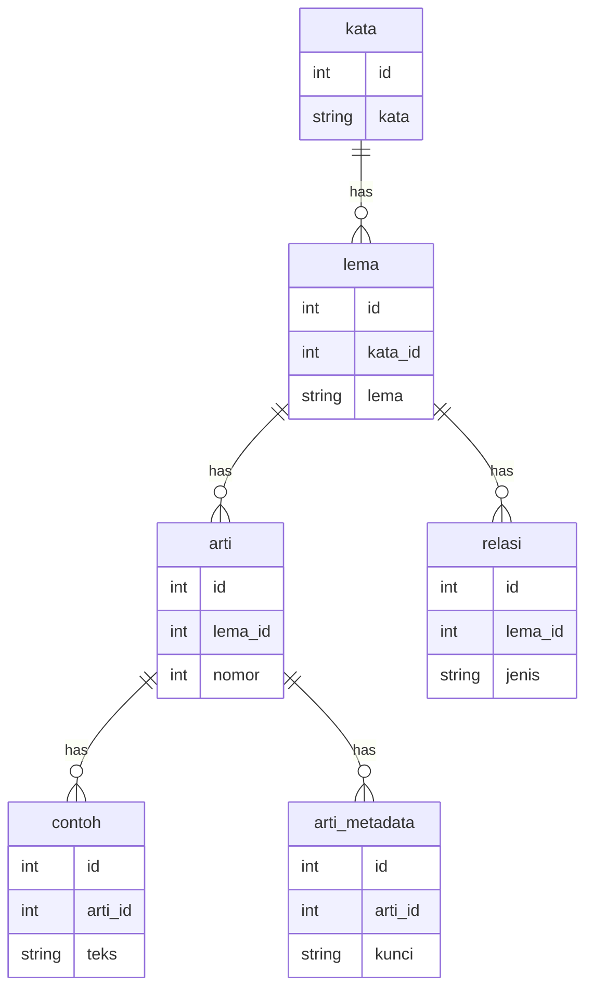

# Database design

This database is for **people**, not for a search backend.  It is built around
the structure a reader already understands:

```text
kata 1 ── N lema 1 ── N arti 1 ── N contoh
                         lema 1 ── N relasi
```

- `kata` — the headword page (`aba`, `elang`, `administrasi umum`)
- `lema` — the display blocks under that page (`a.ba (1)` … `a.ba (5)`, `e.lang`)
- `arti` — one meaning/definition per row
- `contoh` — one example per row
- `relasi` — one relation per row

There are no label dictionaries, no full-text shadow tables, no block/offset
columns, and no many-to-many category tables. Multiple values in a single
column are JSON arrays.

The output is `output/kbbi.sqlite` (about 65 MiB for KBBI 6.2.0), built with:

```bash
pixi run db
```

## Model diagram

Source: [`diagrams/06-database-schema.mmd`](diagrams/06-database-schema.mmd).



Companion tables (`kata_hari_ini`, `kata_tahun_ini`, `tentang`, `dokumen`,
`info`) are independent lists — see [§Companion tables](#companion-tables).

## Tables

### `kata` — headwords

| Column | Meaning |
| --- | --- |
| `id` | Simple integer ID |
| `kata` | Headword (`aba`, `elang`, `administrasi umum`) |
| `jenis` | JSON array of entry types, e.g. `["Kata Dasar"]` |
| `kelas_kata` | JSON array of class names, e.g. `["Nomina", "Verba"]` |
| `bahasa` | JSON array of source-language names |
| `bidang` | JSON array of subject fields |
| `ragam` | JSON array of register names |

These categories come from the app’s own category files, so the home and
category screens keep their original membership.

### `lema` — subentries/page blocks

| Column | Meaning |
| --- | --- |
| `id` | Simple integer ID, also the page order |
| `kata_id` | References `kata.id` |
| `lema` | Display lemma with syllable dots, without the `(n)` suffix (`a.ba`, `e.lang`) |
| `homograf` | Homograph number |
| `pelafalan` | Pronunciation (`êlang`) |
| `etimologi` | Etymology |
| `induk` | Parent headword for subentries (`administrasi` for `administrasi umum`) |

A word with five lemas — like `aba` — has one `kata` row and five `lema` rows.

### `arti` — meanings

| Column | Meaning |
| --- | --- |
| `id` | Simple integer ID |
| `lema_id` | References `lema.id` |
| `nomor` | Definition number inside the lemma |
| `arti` | One definition, with labels and inline formatting |
| `kelas_kata` | JSON array of class names for this definition |
| `bahasa` | JSON array of source languages for this definition |
| `bidang` | JSON array of fields for this definition |
| `ragam` | JSON array of registers for this definition |

`arti` uses the same readable markers as the source:

```text
[n] <Sd> sebutan untuk anak lelaki sultan Cirebon
```

`[n]` is part of speech, `<Sd>` language, `{Adm}` field, `(ark)` register, and
`<i>…</i>` is formatting.  It is one definition per row, so there are no
newline-separated lists.

### `arti_metadata` — optional details

Some details are rare and do not deserve a dedicated column.  They live in a
generic key/value table:

| Column | Meaning |
| --- | --- |
| `id` | Simple integer ID |
| `arti_id` | References `arti.id` |
| `kunci` | `label`, `nama_ilmiah`, or `rumus_kimia` |
| `nilai` | The value |

Example rows:

```text
arti_id: 392, kunci: label,       nilai: singkatan
arti_id: 123, kunci: nama_ilmiah, nilai: Accipitridae
```

Use this table for details that are not common enough to be a column.  The
main `arti` columns stay stable and readable.

### `contoh` — examples

| Column | Meaning |
| --- | --- |
| `id` | Simple integer ID |
| `arti_id` | References `arti.id` |
| `urutan` | Example order within the definition |
| `teks` | Example text |

Examples are rows, not a JSON array or a newline-separated cell, because they
belong to a specific meaning.

### `relasi` — related words

| Column | Meaning |
| --- | --- |
| `id` | Simple integer ID |
| `lema_id` | References `lema.id` |
| `jenis` | Relation type |
| `target` | Related word |
| `konteks` | Context for `bentuk_tidak_baku`, `lihat`, or `rujukan`; empty for other types |

Relation types: `turunan`, `gabungan_kata`, `peribahasa`, `kiasan`, `varian`,
`dasar`, `bentuk_tidak_baku`, `lihat`, `rujukan`.

One relation per row, so “Gabungan kata” with 27 items is 27 rows, not one
large cell.

### Companion tables

| Table | Contents |
| --- | --- |
| `kata_hari_ini` | Word-of-the-day sequence |
| `kata_tahun_ini` | Kata Tahun Ini HTML (2019–2025) |
| `tentang` | About pages |
| `dokumen` | PDF/font metadata; files are copied to `output/dokumen/` |
| `info` | Build metadata and counts |

`dokumen.berkas` is relative to the output folder, for example
`dokumen/docs/tanda_dan_lambang.pdf`.  The actual PDF and font-license files
live next to the database, not inside the original decoded APK tree.

## Multiple values are JSON arrays

For example, this is how `aba` looks:

```sql
SELECT * FROM kata WHERE kata = 'aba';
```

```text
kata:       aba
jenis:      ["Kata Dasar"]
kelas_kata: ["Nomina", "Verba"]
bahasa:     ["Lundayeh", "Manggarai", "Marlasi"]
bidang:     []
ragam:      []
```

And its five lemas:

```sql
SELECT id, lema, homograf
FROM lema
WHERE kata_id = (SELECT id FROM kata WHERE kata = 'aba')
ORDER BY id;
```

No cell contains newline-separated values.  Arrays are valid JSON and can be
read by DB Browser, Python, JavaScript, or any SQLite client.

## Using the database

### Lookup without SQL

```bash
pixi run lookup abnormal
pixi run lookup elang
pixi run lookup elang --json
```

### SQL examples

```sql
-- Find a word and its lemas
SELECT k.kata, l.lema, l.homograf, l.pelafalan
FROM kata k
JOIN lema l ON l.kata_id = k.id
WHERE k.kata = 'elang'
ORDER BY l.id;

-- Find one definition and its examples
SELECT k.kata, l.lema, a.nomor, a.arti, c.teks AS contoh
FROM kata k
JOIN lema l ON l.kata_id = k.id
JOIN arti a ON a.lema_id = l.id
LEFT JOIN contoh c ON c.arti_id = a.id
WHERE k.kata = 'abnormal'
ORDER BY l.id, a.nomor, c.urutan;

-- Optional details such as scientific names or labels
SELECT k.kata, l.lema, a.nomor, m.kunci, m.nilai
FROM kata k
JOIN lema l ON l.kata_id = k.id
JOIN arti a ON a.lema_id = l.id
JOIN arti_metadata m ON m.arti_id = a.id
WHERE k.kata = 'elang'
ORDER BY l.id, a.nomor, m.id;

-- Related words
SELECT k.kata, l.lema, r.jenis, r.target
FROM kata k
JOIN lema l ON l.kata_id = k.id
JOIN relasi r ON r.lema_id = l.id
WHERE k.kata = 'elang'
ORDER BY l.id, r.id;

-- Filter by class
SELECT DISTINCT k.kata
FROM kata k
WHERE k.kelas_kata LIKE '%Nomina%'
LIMIT 50;

-- Kata Tahun Ini
SELECT tahun, judul FROM kata_tahun_ini ORDER BY tahun;
```

## Counts

| Table | Rows |
| --- | ---: |
| `kata` | 196,195 |
| `lema` | 211,473 |
| `arti` | 233,579 |
| `arti_metadata` | 19,823 |
| `contoh` | 47,792 |
| `relasi` | 116,439 |
| `kata_hari_ini` | 6,974 |
| `kata_tahun_ini` | 7 |
| `tentang` | 2 |
| `dokumen` | 2 |

## Is information lost?

No:

- Every headword gets a `kata` row.
- Every display block gets a `lema` row, including blocks with no definition
  but with relations.
- Every definition gets an `arti` row.
- Every example gets a `contoh` row.
- Every relation gets a `relasi` row.
- Labels, categories, scientific names, chemical formulas, KTI pages, about
  pages, and documents are all retained.
- Inline formatting is retained as readable tags in `arti`.

## Notes

- `sumber_blok` and `sumber_offset` from the previous design were internal
  CAV provenance pointers.  They were not useful to a normal reader and are no
  longer in the customer tables.
- `info.sumber_data` is stored as a relative path (`output/dictdata`), not a
  machine-specific work directory.
- `kata` is the headword; `lema` is the displayed syllabified form.  They are
  deliberately separate.
- The previous single `kbbi` table was split into `kata`/`lema`/`arti` because
  a word can have multiple lemas and meanings; this keeps each concept tidy
  without creating a large number of lookup tables.

## Regenerating after a KBBI update

```bash
pixi run decrypt    # only if the decrypted dictdata changed
pixi run db
```

`pixi run db` rebuilds the database and copies `docs`/`fonts` into
`output/dokumen/`.  If a new app version changes the key, nonce, or CAV format,
re-run the key derivation first (see [`decryption.md`](decryption.md)).
