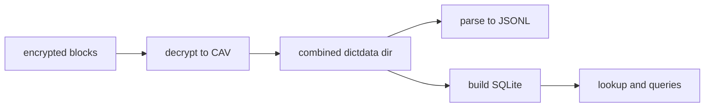

# Data extraction pipeline

This page is the runnable companion to the theory pages. It covers everything
after the key is known: decrypt the blocks, parse the entries, and build the
SQLite database.

- Cipher details → [decryption.md](decryption.md)
- Byte layouts → [file-format.md](file-format.md)
- Final tables → [database.md](database.md)

## Pipeline overview

Source: [`diagrams/05-extraction-pipeline.mmd`](diagrams/05-extraction-pipeline.mmd).



Concretely:

| Stage | Command | Input → Output |
| --- | --- | --- |
| Decrypt | `pixi run decrypt` | `artifacts/decoded/…/dictdata` → `output/dictdata/` |
| Flat extract | `pixi run extract` | `output/dictdata/` → `output/kbbi.jsonl` |
| Database | `pixi run db` | `output/dictdata/` → `output/kbbi.sqlite` + `output/dokumen/` |
| Lookup | `pixi run lookup <kata>` | `output/kbbi.sqlite` → terminal / JSON |

`decrypt` must run before anything else. `extract` and `db` are independent of
each other and both read `output/dictdata/`.

## 1. Decrypt (`pixi run decrypt`)

Decrypts all 28 `acu_desc_*.s` blocks and copies the 435 plaintext files into
one self-contained directory.

```bash
pixi run decrypt
```

What it does per block:

```text
acu_desc_N.s --Salsa20--> GZIP bytes --gunzip--> acu_desc_N.cav
```

Then it copies every non-encrypted file (`acu_nilai.txt`, `acu_offlens.txt`,
`stats.txt`, `kat_*.txt`, …) next to the `.cav` files. The result:

```text
output/dictdata/
├── acu_desc_0.cav … acu_desc_27.cav
├── acu_nilai.txt
├── acu_offlens.txt
└── kat_*.txt, stats.txt, …
```

Useful variants:

```bash
# Explicit input/output
DICTDATA=artifacts/decoded/assets/composeResources/kbbi6.composeapp.generated.resources/files/dictdata
pixi run python scripts/decrypt_dict.py "$DICTDATA" -o output/dictdata

# Keep the intermediate GZIP stream instead of gunzipped CAV
pixi run python scripts/decrypt_dict.py --raw-gzip -o output/raw

# Re-decrypt everything
pixi run python scripts/decrypt_dict.py --force -o output/dictdata
```

Verification: `pixi run info` lists word/offset/block counts from the combined
directory without rewriting files.

## 2. Flat extract (`pixi run extract`)

Parses every entry into one JSON object per line. This is the legacy view —
convenient for diffing and scripting, but coarser than SQLite (subentries are
grouped into one string per word; see [audit.md](audit.md)).

```bash
pixi run extract
```

Variants:

```bash
# First 3 entries as pretty JSON on stdout
pixi run python scripts/extract_dict.py --limit 3 --format json

# One headword to a file
pixi run python scripts/extract_dict.py --word rumah --format json -o output/rumah.json

# Custom input/output
pixi run python scripts/extract_dict.py output/dictdata -o output/kbbi.jsonl
```

Record shape (empty fields omitted):

```json
{
  "kata": "rumah",
  "lema": ["ru.mah"],
  "makna": ["[n] bangunan untuk tempat tinggal ..."],
  "contoh": ["..."],
  "pelafalan": "..."
}
```

## 3. Database (`pixi run db`)

Builds the customer-facing database (see [database.md](database.md)):

```bash
pixi run db
```

What it does:

1. Loads `kata` from `acu_nilai.txt` and offsets from `acu_offlens.txt`.
2. Parses each CAV stream into subentries → definitions → examples → relations
   (`src/kbbi_extract/structured.py`).
3. Joins the app's own `kat_*` category files for `jenis`, `kelas_kata`,
   `bahasa`, `bidang`, `ragam`.
4. Writes `kata`, `lema`, `arti`, `arti_metadata`, `contoh`, `relasi` plus
   `kata_hari_ini`, `kata_tahun_ini`, `tentang`, `dokumen`, `info`.
5. Copies `docs/` + `fonts/` assets into `output/dokumen/` and records them in
   the `dokumen` table.

Result:

```text
output/
├── kbbi.sqlite      # ~65 MiB
└── dokumen/
    ├── docs/tanda_dan_lambang.pdf
    └── fonts/roboto-license.txt
```

Expected row counts for KBBI 6.2.0:

| Table | Rows |
| --- | ---: |
| `kata` | 196,195 |
| `lema` | 211,473 |
| `arti` | 233,579 |
| `arti_metadata` | 19,823 |
| `contoh` | 47,792 |
| `relasi` | 116,439 |

## 4. Lookup and queries

No-SQL lookup:

```bash
pixi run lookup abnormal
pixi run lookup elang
pixi run lookup elang --json
pixi run lookup "administrasi umum"
```

Multi-word headwords need quotes. `--json` prints the nested word object.

SQL starting points (full recipes in [database.md](database.md)):

```sql
-- Display blocks for a word
SELECT id, lema, homograf, pelafalan, induk FROM lema
WHERE kata_id = (SELECT id FROM kata WHERE kata = 'aba') ORDER BY id;

-- Meanings + examples for one word
SELECT a.nomor, a.arti, c.teks AS contoh
FROM kata k
JOIN lema l ON l.kata_id = k.id
JOIN arti a ON a.lema_id = l.id
LEFT JOIN contoh c ON c.arti_id = a.id
WHERE k.kata = 'abnormal'
ORDER BY l.id, a.nomor, c.urutan;
```

## Outputs at a glance

| Path | Description | Committed? |
| --- | --- | --- |
| `output/dictdata/` | 28 `.cav` + 435 plaintext files | Yes |
| `output/kbbi.jsonl` | 196,195 flat entries | Yes |
| `output/kbbi.sqlite` | Customer database | Yes |
| `output/dokumen/` | PDF + font license | Yes |
| `artifacts/` | XAPK, APKTool jar, unpacked + decoded tree, logs | Yes (input + tools + unpacked + decoded) |

## Troubleshooting

| Symptom | Fix |
| --- | --- |
| `no acu_desc_*.s files found` | Run `pixi run unpack` + `pixi run decode` first, or pass the dictdata dir explicitly |
| `gzip.BadGzipFile` during decrypt | Wrong key/nonce or truncated block — see [decryption.md](decryption.md#troubleshooting) |
| `database already exists` | `pixi run db` always rebuilds with `--force`; the direct script needs `--force` too |
| Stale output after app update | Re-run `unpack` → `decode` → `decrypt` → `db` in order |
