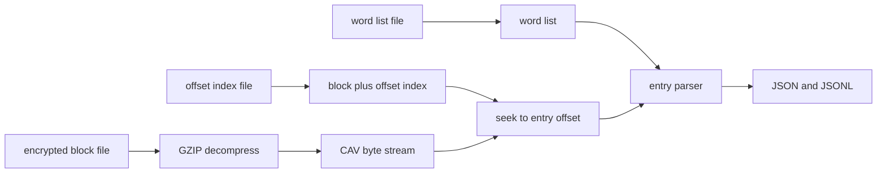

# Binary file format

The KBBI app stores the dictionary in a small custom binary format. This page
documents the parts needed to decrypt and parse the data. All multi-byte
integers below are big-endian unless the format explicitly says otherwise.

For the runnable steps that use these formats, see
[extraction.md](extraction.md). For the final tables, see
[database.md](database.md).

## Overview

| File | Encryption | Payload |
| --- | --- | --- |
| `acu_nilai.txt` | none | Headword list |
| `acu_offlens.txt` | none | Delta-encoded block/offset index |
| `acu_desc_N.s` | Salsa20 + GZIP | CAV description stream |
| `stats.txt` | none | CAV counters |
| `kat_*.txt` | none | CAV category lists |
| `wotd_acu_ids.txt` | none | CAV integer list |

The word list and offset table are paired: entry `i` in `acu_nilai.txt` is
described at offset `i` in `acu_offlens.txt`.

Source: [`diagrams/04-file-format.mmd`](diagrams/04-file-format.mmd).



Concretely: `A` is `acu_nilai.txt` (varint count, then one length byte plus
UTF-8 per word); `B` is `acu_offlens.txt` (varint count, then delta-encoded
entries); `C` is one `acu_desc_N.s` file (Salsa20 ciphertext of a GZIP stream).

## Variable-length integers (`ValueReader`)

The format uses a prefix byte to encode lengths and integer values:

| Prefix | Following bytes | Value |
| --- | --- | --- |
| `0x00`–`0xef` | none | The byte itself |
| `0xfe` | 1 byte | That byte |
| `0xfd` | 1 byte | `byte \| 0x100` |
| `0xfc` | 2 bytes | `(b1 << 8) \| b2` |
| `0xfb` | 2 bytes | `(b1 << 8) \| 0x10000 \| b2` |
| `0xfa` | 3 bytes | `(b1 << 16) \| (b2 << 8) \| b3` |

`0xf0`–`0xf9` are invalid as varint prefixes in this format. Strings are
length-prefixed with a varint and encoded as UTF-8.

> Note: the word list uses a single unsigned byte for each word length, not a
> varint. The other files use the table above.

## `acu_nilai.txt` — headwords

```text
varint        word_count
repeat word_count:
    uint8     byte_length
    bytes     UTF-8 headword
```

Example (synthetic):

```text
03                    # 3 words
03 61 62 63           # "abc"
05 72 75 6d 61 68     # "rumah"
02 33 6d              # "3m"
```

The 6.2.0 file contains 196,195 words, beginning with `3m`, `3s`, `a`, `a-`,
`à`.

## `acu_offlens.txt` — entry index

```text
varint        entry_count
file_no = -1
offset  = 0
repeat entry_count:
    varint    delta
    if delta == 0xffff:
        file_no += 1
        delta = varint
        offset = 0
    store (file_no, offset)
    offset += delta
```

The stored 32-bit value used by the app is:

```text
(file_no << 24) | offset
```

- `file_no` selects `acu_desc_<file_no>.s`.
- `offset` is a byte offset in the **decompressed** CAV stream.
- The first entry normally begins with the `0xffff` marker, which starts
  `file_no` at 0.

## `acu_desc_N.s` — description blocks

One file contains many entries. Each entry is located by an offset from
`acu_offlens.txt` and is decoded until the `0xff` terminator.

```text
acu_desc_N.s
    -> Salsa20/20 (fixed key + nonce)
    -> GZIP
    -> CAV byte stream
    -> seek(offset)
    -> read CAV records until 0xff
```

The blocks are ~950 KB of CAV data after decompression. The last block
(`acu_desc_27.s`) is smaller because it contains the tail of the dictionary.

## CAV records

CAV stands for **Code-Attribute-Value**. Each record starts with a one-byte
code; the code determines whether the record has a string, an integer, or no
argument.

### String-valued codes

| Code | Meaning |
| ---: | --- |
| 0 | Definition text |
| 1 | Lemma |
| 2 | Pronunciation |
| 3 | Related entry (used as display lemma) |
| 4 | Etymology |
| 5 | Lemma (bold italic) |
| 20 | Part of speech / word class |
| 21 | Source language |
| 22 | Subject field |
| 23 | Scientific name |
| 24 | Chemical formula |
| 25 | Register / usage label |
| 42 | Bold text |
| 50 | Usage example |
| 60 | Bold run |
| 61 | Italic run |
| 62 | Subscript |
| 63 | Superscript |
| 74 | Colored subscript |

### Integer-valued codes

| Code | Meaning |
| ---: | --- |
| 40 | Reference to a headword index (1-based) |
| 41 | Arrow/reference index (1-based) |

The integer is a varint. The parser resolves it with `words[number - 1]`; an
out-of-range value is rendered as `#<number>`.

### Argument-less codes

| Code | Meaning |
| ---: | --- |
| 10 | Section marker: variants |
| 11 | Section marker: base words |
| 12 | Section marker: compound words |
| 13 | Section marker: derived words |
| 14 | Section marker: proverbs |
| 15 | Section marker: figurative senses |
| 30 | Label `ki` (figurative) |
| 31 | Label `kp` (shortened form) |
| 32 | Label `akr` (acronym) |
| 33 | Label `ukp` (expression) |
| 34 | Label `sing` (abbreviation) |
| 255 | End of entry |

### Synthetic examples

```text
01 05 72 75 6d 61 68 ff
```

- `01` = lemma
- `05` = string length 5
- `72 75 6d 61 68` = "rumah"
- `ff` = end

```text
01 05 72 75 6d 61 68
02 06 72 75 2e 6d 61 68
14 03 6e 6f 6d
00 08 62 61 6e 67 75 6e 61 6e
ff
```

- `02` = pronunciation "ru.mah"
- `14` (20) = part of speech "nom"
- `00` = definition text "bangunan"
- `ff` = end

## Entry parser behaviour

The Python parser follows the app's display semantics:

1. `0` text is appended to the current definition.
2. Codes `10`–`15` flush the current definition and switch sections.
3. Codes `20`–`25`, `42`, `60`–`63`, and `74` are formatted into the current
   definition (`[n]`, `<Latin>`, `{Biology}`, etc.).
4. `50` records are collected as usage examples.
5. `40`/`41` references are resolved against the headword list and placed in
   the current section.
6. `255` flushes the final definition and ends the entry.

The flat view from `python scripts/extract_dict.py` is one JSON object per
entry:

```json
{
  "kata": "rumah",
  "lema": ["ru.mah"],
  "makna": ["[n] bangunan untuk tempat tinggal ..."],
  "contoh": ["..."],
  "turunan": ["..."],
  "gabungan_kata": ["..."],
  "peribahasa": ["..."],
  "kiasan": ["..."],
  "varian": ["..."],
  "dasar": ["..."],
  "pelafalan": "...",
  "etimologi": "..."
}
```

Empty fields are omitted. Note this flat view is lossier than SQLite: it
groups subentries into one string per word. The customer database in
[database.md](database.md) keeps one row per subentry/definition instead.

## Other files

- `stats.txt` — CAV records with counters such as `entry_count`, `acu_count`,
  and `kategori_count`.
- `wotd_acu_ids.txt` — a CAV integer list of word-of-the-day entry indices.
- `kat_index_*.txt` — category index lists.
- `kat_bahasa_*.txt`, `kat_bidang_*.txt`, `kat_jenis_*.txt`, `kat_kelas_*.txt`,
  `kat_ragam_*.txt` — CAV lists for languages, fields, types, word classes,
  and registers.
- `kat_index_*.txt` files are mostly readable strings; the `kat_*` data files
  are often binary lists of indices even though they use a `.txt` suffix.

## Reference implementation

The parsers are in:

- [`src/kbbi_extract/format.py`](../src/kbbi_extract/format.py) — varint and CAV.
- [`src/kbbi_extract/dictionary.py`](../src/kbbi_extract/dictionary.py) — word
  list, offsets, and entry assembly.

For the original app's smali paths, see
[references.md](references.md).
