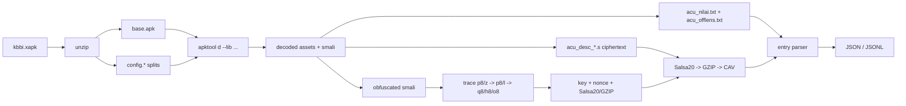
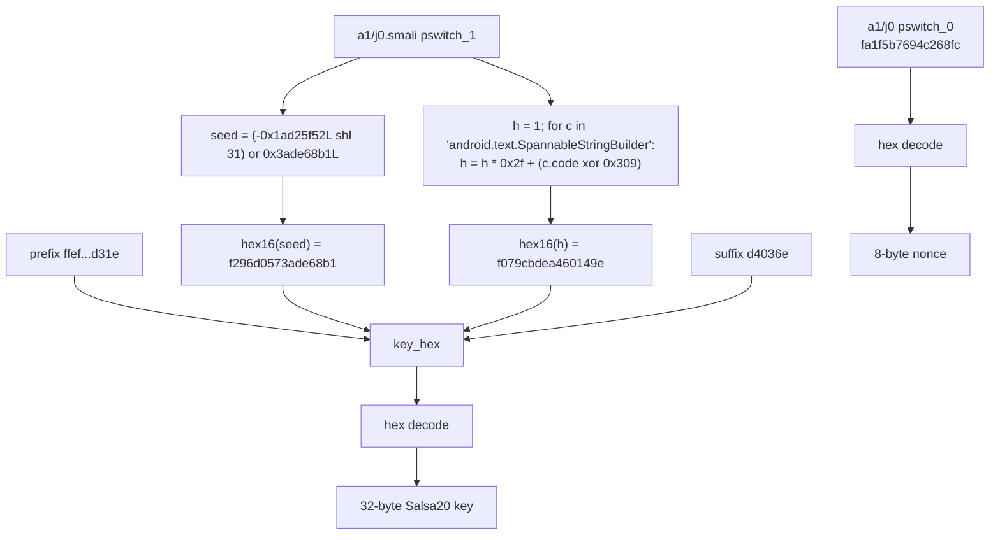
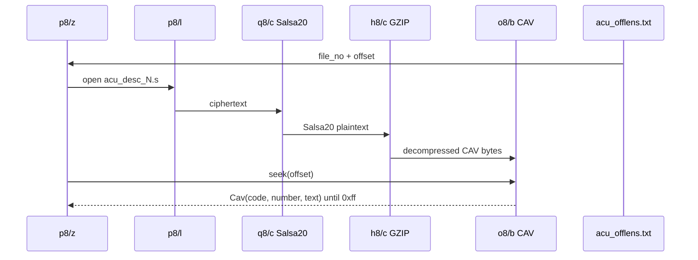

# Reverse engineering the KBBI 6.2.0 dictionary data

This document records the complete path from `kbbi.xapk` to the Salsa20 key and
the decrypted CAV payload.  It is written to be reproducible: every command,
observed file, smali reference, and verification figure is included.

## 1. Target

| Field | Value |
| --- | --- |
| Input | `kbbi.xapk` (APKPure XAPK) |
| Package | `yuku.kbbi5` |
| App name | KBBI |
| Version | 6.2.0 |
| Version code | 640 |
| Min SDK | 24 |
| Target SDK | 36 |
| Base APK | `yuku.kbbi5.apk` |
| Splits | `config.arm64_v8a`, `config.en`, `config.fr`, `config.xxhdpi` |

The XAPK is a ZIP container, not an APK.  Relevant members:

| Member | Size | Purpose |
| --- | ---: | --- |
| `yuku.kbbi5.apk` | 15.4 MB | Base APK: manifest, dex, resources, assets |
| `config.arm64_v8a.apk` | 1.9 MB | Native libraries only |
| `config.en.apk` | 69 KB | English resources |
| `config.fr.apk` | 25 KB | French resources |
| `config.xxhdpi.apk` | 49 KB | xxhdpi resources |
| `manifest.json` | 619 B | APKPure metadata |

## 2. Toolchain

The exact versions used for this write-up:

| Tool | Version |
| --- | --- |
| APKTool | 3.0.3 |
| Java | OpenJDK 27 (pixi project environment) |
| Python | 3.12.16 (pixi project environment) |
| PyCryptodome | 4.4.0 (pixi project environment) |
| jadx | optional, for cross-checking |
| APKEditor | optional, for splitting/merging experiments |

APKTool 3.0.2 or newer is required for split-APK library loading.  The older
2.x series does not support `--lib` for split APKs.

## 3. Unpack the XAPK

```bash
unzip kbbi.xapk -d xapk
```

You should see the members listed in section 1.  Do **not** run `apktool d`
directly on the `.xapk`: APKTool 3.0.3 does not recognize the container and
copies every member into `unknown/` instead of decoding the base APK.

## 4. Decode the base APK with its splits

APKTool needs the resource-bearing splits as libraries so references in the
base APK resolve correctly:

```bash
java -jar apktool_3.0.3.jar d xapk/yuku.kbbi5.apk \
    -o decoded \
    -f \
    --lib "yuku.kbbi5:xapk/config.xxhdpi.apk,xapk/config.en.apk,xapk/config.fr.apk"
```

`--lib` format is `<package>:<path>`.  Multiple libraries for the same package
are comma-separated after the colon.

Why `config.arm64_v8a.apk` is excluded:

```text
Exception: Could not find resources.arsc in file: config.arm64_v8a.apk
```

It is a native-library split and has no resource table.  Passing it as a
library makes APKTool fail before decoding starts.

The decode should finish with:

```text
I: Loading resource table...
I: Baksmaling classes.dex...
I: Baksmaling classes2.dex...
I: Decoding value resources...
I: Decoding file resources...
I: Decoding AndroidManifest.xml with resources...
I: Copying original files...
I: Copying assets...
I: Copying unknown files...
```

The decoded tree is about 62 MB and contains 4,036 smali files.

## 5. Locate the dictionary assets

The dictionary payload is under:

```text
artifacts/decoded/assets/composeResources/
└── kbbi6.composeapp.generated.resources/
    └── files/
        └── dictdata/
            ├── acu_nilai.txt
            ├── acu_offlens.txt
            ├── acu_desc_0.s … acu_desc_27.s
            ├── stats.txt
            ├── wotd_acu_ids.txt
            └── kat_*.txt
```

Initial observations:

| File family | Appearance | Reality |
| --- | --- | --- |
| `acu_nilai.txt` | Readable headwords separated by length bytes | Plaintext custom binary |
| `acu_offlens.txt` | High-entropy binary | Plaintext delta-encoded offsets |
| `acu_desc_*.s` | High-entropy binary | Salsa20 ciphertext, then GZIP |
| `stats.txt` | Mixed binary/ASCII | Plaintext CAV records |
| `kat_*.txt` | Binary/UTF-8 | Plaintext CAV records |

Only `acu_desc_*.s` is encrypted.

## 6. Trace the decryption path

The relevant code is in obfuscated smali packages.  The path is:

```text
p8/z  -> p8/l -> q8/c -> q8/a -> h8/c -> o8/b
```

| Step | File | What happens |
| --- | --- | --- |
| 1 | `smali/p8/z.smali:385-468` | Opens `files/dictdata/acu_desc_<N>.s`, seeks to the entry offset from `p8/z.b`, then reads CAV records until `0xff`. |
| 2 | `smali/p8/l.smali:42-80` | Declares two lazy byte arrays: `b` (32-byte key) and `c` (8-byte nonce). |
| 3 | `smali/p8/l.smali:319-361` | Fetches both arrays and constructs `q8/c(buffer, key, nonce)` → `q8/a(...)` → `o8/b(...)`. |
| 4 | `smali/q8/c.smali:64` | Salsa20 stream wrapper.  XORs input bytes with the Salsa20 keystream. |
| 5 | `smali/q8/a.smali:14` | Wraps the Salsa20 stream in `h8/c`, which is a GZIP source. |
| 6 | `smali/h8/c.smali:16-80` | GZIP header parsing, `Inflater`, CRC32, and trailer validation. |
| 7 | `smali/o8/b.smali:322-770` | CAV reader: `Cav(code, number, string)` records, terminated by code `0xff`. |

The key is not in `p8/l` itself.  `p8/l.b` and `p8/l.c` are `r6/j` lazy values
whose supplier is the synthetic lambda class `a1/j0`.

## 7. Recover the key

`a1/j0.smali` is a synthetic lambda with a `packed-switch` on its constructor
argument.  The two cases used by `p8/l` are:

- `pswitch_0` (case 28) → nonce
- `pswitch_1` (case 27) → key

### 7.1 Nonce

`a1/j0.smali:107-126` returns the bytes of the literal:

```text
fa1f5b7694c268fc
```

`b/j0` (the hex parser, case 28) converts it to 8 bytes.

### 7.2 Key

`a1/j0.smali:127-235` builds a 64-character hex string:

```text
seed = (-0x1ad25f52L shl 31) or 0x3ade68b1L

h = 1
for c in "android.text.SpannableStringBuilder":
    h = h * 0x2f + (c.code xor 0x309)

key_hex = "ffef8a8d11f535b73cd24fd31e" +
          hex16(seed) +
          hex16(h) +
          "d4036e"
```

`hex16` is `p8/n.c(long)`: `Long.toString(value, 16)` followed by left-padding
with `0` to 16 characters (`n7/i.u0`).  The arithmetic is 64-bit; this matters.

Evaluating the constants gives:

| Value | Hex |
| --- | --- |
| Seed | `f296d0573ade68b1` |
| Hash | `f079cbdea460149e` |
| Prefix | `ffef8a8d11f535b73cd24fd31e` |
| Suffix | `d4036e` |

Final key:

```text
ffef8a8d11f535b73cd24fd31ef296d0573ade68b1f079cbdea460149ed4036e
```

Nonce:

```text
fa1f5b7694c268fc
```

> **jadx warning.**  A Java decompiler can render the Kotlin expression as a
> 32-bit `hashCode() << 31`, which produces the wrong key.  The smali
> `int-to-long` followed by `shl-long` is the authoritative 64-bit operation.
> The public `Definisi/kbbi` extractor independently confirms this key.

## 8. Verify the pipeline

PyCryptodome's Salsa20 with the key and nonce above decrypts every block to a
valid GZIP stream:

```python
from Crypto.Cipher import Salsa20
import gzip

key = bytes.fromhex(
    "ffef8a8d11f535b73cd24fd31ef296d0573ade68b1f079cbdea460149ed4036e"
)
nonce = bytes.fromhex("fa1f5b7694c268fc")

ciphertext = open("acu_desc_0.s", "rb").read()
plaintext_gzip = Salsa20.new(key=key, nonce=nonce).decrypt(ciphertext)
cav = gzip.decompress(plaintext_gzip)
```

Observed results:

| Metric | Value |
| --- | ---: |
| Blocks decrypted | 28 / 28 |
| Ciphertext bytes | 8,860,079 |
| Gunzipped CAV bytes | 26,240,696 |
| `acu_desc_0.s` ciphertext | 321,856 |
| `acu_desc_0.s` CAV output | 950,104 |
| Headwords | 196,195 |
| Offset entries | 196,195 |

`acu_desc_0.s` starts with `1f 8b 08 00` (GZIP) after Salsa20, and the
decompressed stream starts with CAV code `03` (`string follows`).

## 9. Flowcharts

### 9.1 End-to-end analysis



### 9.2 Key derivation



### 9.3 Runtime file read



## 10. Reference files

All paths are relative to the decoded APK tree produced in section 4.

| Path | Relevant lines | Why it matters |
| --- | --- | --- |
| `smali/p8/l.smali` | 42-80, 319-361 | Lazy key/nonce fields; Salsa20 → GZIP → CAV construction |
| `smali/a1/j0.smali` | 107-126 | Nonce literal |
| `smali/a1/j0.smali` | 127-235 | Key assembly, seed, rolling hash |
| `smali/p8/n.smali` | 3300-3385 | Zero-padded 16-character hex helper |
| `smali/b/j0.smali` | 848-1035 | Hex-string to byte-array parser |
| `smali/q8/b.smali` | 34-180 | Salsa20 state initialization and validation |
| `smali/q8/c.smali` | 64-… | Salsa20 stream XOR |
| `smali/q8/a.smali` | 14-57 | GZIP wrapper construction |
| `smali/h8/c.smali` | 16-80, 990-1191 | GZIP header/trailer validation |
| `smali/o8/b.smali` | 322-770 | `Cav(code, number, string)` reader |
| `smali/p8/z.smali` | 385-468 | Opens `acu_desc_<N>.s`; seeks and reads records |
| `smali/p8/j.smali` | 1278-1294 | Builds block number + 24-bit offset reference |
| `smali/p8/b.smali` | 331, 654, 951 | Reads `wotd_acu_ids.txt`, `acu_offlens.txt`, `acu_nilai.txt` |
| `smali/p8/t.smali` | 401 | Reads `kat_*` category files |
| `smali/u0/a.smali` | 7134 | Reads `stats.txt` |
| `AndroidManifest.xml` | application block | PairIP wrapper and license activity |

External references:

- [APKTool 3.x documentation](https://apktool.org/docs/cli-parameters)
- [APKTool 3.0.3 release](https://apktool.org/blog/apktool-3.0.3)
- [APKTool split-APK library support (PR #4128)](https://github.com/iBotPeaches/Apktool/pull/4128)
- [PyCryptodome Salsa20](https://pycryptodome.readthedocs.io/en/latest/src/cipher/salsa20.html)
- [@stablelib/salsa20](https://www.npmjs.com/package/@stablelib/salsa20)
- [Definisi/kbbi reference extractor](https://github.com/Definisi/kbbi)

## 11. Pitfalls

1. **XAPK is not APK.**  `apktool d kbbi.xapk` does not decode the app.  In
   APKTool 3.0.3 it copied members into `unknown/` and exited successfully,
   which is easy to misread as success.
2. **The arm64 split has no resources.**  Do not add
   `config.arm64_v8a.apk` to `--lib`.
3. **`--lib` is resolution, not merging.**  Split resources are not copied
   into the decoded base tree.  Decode splits separately or merge with
   APKEditor if you need their contents.
4. **64-bit shift.**  Decompilers may collapse the seed computation to 32 bits.
   Use the smali semantics.
5. **The rebuilt APK is unsigned.**  `artifacts/build/yuku.kbbi5-base.apk` is
   only a build check.  It needs signing and the config splits to install.
6. **PairIP.**  The manifest uses `com.pairip.application.Application` and a
   `LicenseActivity`; a re-signed build may fail runtime license checks.
7. **Line numbers drift.**  Reference line numbers are from APKTool 3.0.3 on
   KBBI 6.2.0.  They can shift in other versions.

## 12. Reproduction commands

From the repository root:

```bash
pixi install
pixi run setup-apktool
pixi run unpack
pixi run decode
pixi run decrypt
pixi run extract
```

Expected decryptor summary:

```text
done: 28 written, 0 skipped, 28 total; 8,860,079 ciphertext bytes -> 26,240,696 plaintext bytes
plaintext: 435 copied, 0 skipped
```

## 13. Reusing the pipeline for a newer version

The extraction pipeline is data-driven where it matters:

- `decode_apk.py` reads `manifest.json` for the package name and base APK,
  and auto-selects the non-ABI `config.*` splits.  Use `--package`, `--base`,
  or `--unpacked` to override detection.
- The CLI discovers `<decoded>/assets/composeResources/*/files/dictdata`, so
  a renamed generated-resources package does not break the default path.
- Block count, word count, offsets, and entries are parsed from the new
  files.  Nothing assumes 28 blocks or 196,195 words.

The version-specific part is the key/nonce and the Salsa20/GZIP container.  A
database-only update normally leaves those unchanged.  If decryption fails
with a GZIP error, re-derive the constants from the new `a1/j0`/`p8/l` smali
and update `src/kbbi_extract/crypto.py`.
